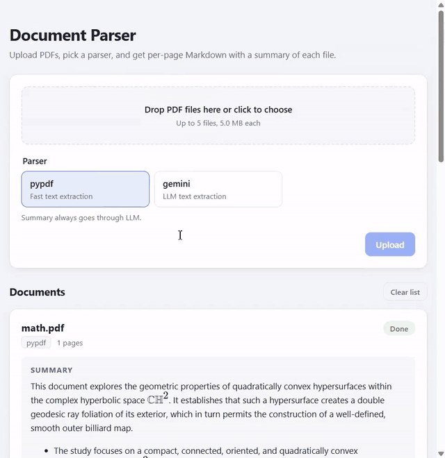
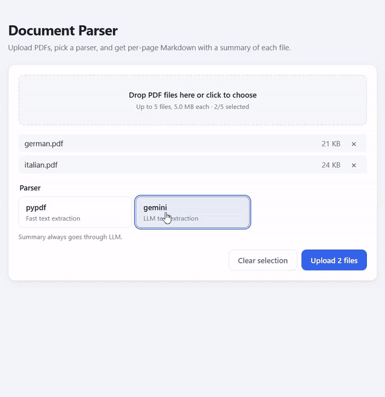

# Document Parser & Summarizer

Upload one or more PDFs, choose a parser (PyPDF or Google Gemini), and get per-page Markdown plus a summary of each file. Processing is asynchronous: the API queues jobs in a Redis Stream and worker processes parse and summarize them.

## Demo



A scanned 1914 letter: PyPDF finds no text layer, Gemini transcribes it and writes the summary.



German and Italian documents: the language is detected per page and each summary is written in it (`Summary · DE`, `Summary · IT`). The wait while Gemini works is cut out.

The full recording, [demo/demo.mp4](demo/demo.mp4), also shows live status updates, readable errors for encrypted and non-PDF files, an instant result from the cache on a repeated upload, and the language example.

## Scope

**Minimal scope:**

1. Async FastAPI backend serving concurrent requests
2. PDF upload and parsing with PyPDF
3. Asynchronous processing through a Redis Streams queue (consumer group, worker processes)
4. Summaries with `gemini-3.1-flash-lite`
5. Gemini as a second parser (PDF → Markdown, works on scans), everything wrapped in Docker Compose
6. A simple React upload page: choose files and a parser, see per-page content and the summary of each file

**Additional features:**

- Queue reliability: crash recovery with `XAUTOCLAIM`, lease renewal, dead-letter stream, worker healthchecks
- Result cache by SHA-256: a repeated upload is served instantly
- Long documents: map-reduce summarization, page-by-page Gemini parsing in chunks
- Summary language detected per page (fastText), shown on the card
- Prompt-injection guard: document text is passed as data inside tags
- Frontend: live updates over SSE (polling kept as a fallback), nginx as the reverse proxy, polished TypeScript UI
- An `examples/` corpus of edge-case PDFs (scans, broken fonts, encrypted, corrupted, decompression bomb, hidden prompt injection) with expected results, unit/integration/live tests
- Demo recordings

## Architecture

```
browser ── nginx :8080 ──/api──► FastAPI api :8000 ──XADD──► Redis 7.4 stream docs:jobs
                                     ▲  SSE /api/events            │ consumer group "parsers"
                                     └── Pub/Sub doc:{id}:events ◄─ worker ×2 (PyPDF / Gemini → summary)
```

- API: FastAPI. Uploads go to a shared volume, documents and jobs go to Redis in one transaction (`202 Accepted`).
- Workers: Redis Streams consumer group with crash recovery (`XAUTOCLAIM`), lease renewal, dead-letter stream, result cache by SHA-256.
- Parsers: `pypdf` (text) and `gemini` (`gemini-3.1-flash-lite`, Markdown, works on scans and images). Summaries: Gemini via Pydantic AI, written in the document's language. The language is detected per page with fastText (`fast-langdetect`, offline `lite` model) and weighted by text length; near ties go to the language that appears first (the card shows `DE (mixed: DE, IT)`), and documents with no usable text fall back to `EN`.
- Frontend: Vite + React + TypeScript, live updates over Server-Sent Events with polling fallback.

## Run

```bash
cp .env.example .env              # put your GEMINI_API_KEY there (optional)
docker compose up --build -d
```

| URL | What |
|---|---|
| http://localhost:8080 | Web UI |
| http://localhost:8000/docs | API (Swagger UI) |
| http://localhost:8000/health, /ready | liveness / readiness |

Without `GEMINI_API_KEY` the app still works: only `pypdf` is offered and documents finish without a summary (the card says why).

## Try it with the files in `examples/`

Open http://localhost:8080, pick files, pick a parser, press **Upload**. Each file gets a card that moves through *Queued → Parsing… → Summarizing… → Done* without reloading the page.

| # | Files | Parser | What you should see |
|---|---|---|---|
| 1 | `text.pdf`, `german.pdf`, `italian.pdf` | pypdf | All *Done* in a few seconds; 8, 6 and 9 pages; the Universal Declaration of Human Rights summarized in English, German and Italian, each in the document's own language |
| 2 | `scanned.pdf` | pypdf | *Done*, page 1 shows "No text", summary: "No extractable text to summarize; try the Gemini parser" |
| 3 | `scanned.pdf` | gemini | Page 1 is the transcribed 1914 Western Union letter to Theodore Roosevelt; the summary describes the letter |
| 4 | `image.pdf` | pypdf / gemini | pypdf: only the title and caption. gemini: the comic's speech bubbles ("WE ARE HERE AT LAST…") |
| 5 | `broken-font.pdf` | pypdf / gemini | pypdf: garbage such as `/BX/DC/D4` (font without a Unicode map). gemini: the real paper text "Experiments with Open-Domain Textual Question Answering" |
| 6 | `table.pdf` | gemini | Pages rendered as Markdown tables (`\| 2,975 \| 3,000 \| …`) |
| 7 | `encrypted.pdf` | any | *Failed*: "The PDF is protected by a password" |
| 8 | `corrupted.pdf`, `unsafe-decompression-bomb.pdf` | pypdf | *Failed*: "The file is not a readable PDF" |
| 9 | `not-pdf.pdf` or `empty.pdf` | any | Upload is rejected immediately with "… is not a PDF" (HTTP 415); nothing from that batch is queued |
| 10 | `unsafe-prompt-injection.pdf` | pypdf | Pages contain the hidden `PWNED-…` markers (extracted text), but the summary is an ordinary summary of the declaration: the hidden instructions are not followed |
| 11 | `owner-only.pdf`, `rotated.pdf`, `blank-page.pdf` | pypdf | *Done*, 8–9 pages; the inserted blank page shows "No text" |
| 12 | `large.pdf` (142 pages) | pypdf | Takes about a minute; the card stays live while it works |
| 13 | `text.pdf` again | pypdf | *Done* almost instantly: the result comes from the cache |

## Tests

```bash
uv sync
uv run pytest                     # unit + API tests, PyPDF checks against examples/expected.toml
uv run pytest -m integration      # real Redis from docker compose (localhost:6379)
uv run pytest -m live             # real Gemini API (needs GEMINI_API_KEY in .env)
uv run pytest -m slow             # large.pdf
uv run ruff check && uv run mypy src
uv run python scripts/smoke.py    # end-to-end against the running stack
cd frontend && npm ci && npm run build
```

## Configuration

Environment variables (see `src/docparser/config.py` for all of them):

| Variable | Default | Meaning |
|---|---|---|
| `GEMINI_API_KEY` | – | Enables the Gemini parser and summaries |
| `GEMINI_MODEL` | `gemini-3.1-flash-lite` | Gemini model |
| `GEMINI_PAGES_PER_CHUNK` | `5` | Pages sent to Gemini per request |
| `GEMINI_MAX_CONCURRENCY` | `2` | Parallel Gemini requests per document |
| `MAX_FILES_PER_UPLOAD` | `5` | Files per request |
| `MAX_UPLOAD_SIZE_BYTES` | 5 MB | Per file; there is no separate total limit |
| `WORKER_CONCURRENCY` | `4` | Jobs per worker process |
| `RECLAIM_IDLE_MS` | `60000` | Idle time before another worker takes over a job |
| `MAX_DELIVERIES` | `3` | Deliveries before a job goes to `docs:jobs:dlq` |

## Adding a parser

Subclass `BaseParser` (`src/docparser/parsers/base.py`), add a value to `ParserType` (`src/docparser/models.py`) and a `case` in `get_parser()` (`src/docparser/parsers/__init__.py`).
